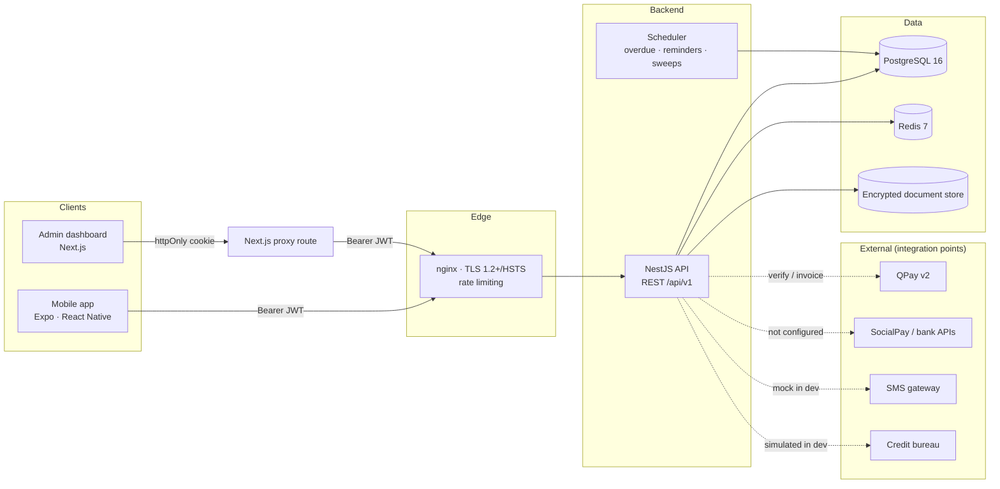
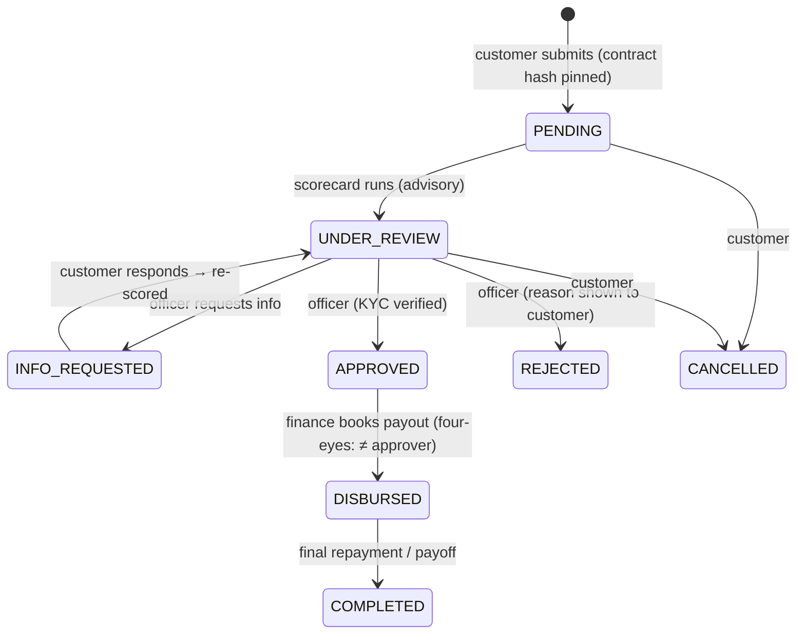

# Architecture

## System overview

## Monorepo

| Path | Purpose |
|---|---|
| `apps/api` | NestJS REST API, Prisma schema & migrations, seed, jobs |
| `apps/admin` | Next.js 14 admin console (App Router, Tailwind, shadcn-style owned components, Recharts) |
| `apps/mobile` | Expo SDK 52 app (Expo Router, NativeWind v4, TanStack Query) |
| `packages/financial-engine` | Decimal-only loan maths: schedules, quotes, APR (IRR), payoff, payment allocation, penalties |
| `packages/shared` | Domain enums, wire types (DTOs), formatting, Mongolian/English dictionaries |
| `packages/validation` | zod schemas & regexes shared by mobile/admin forms (server re-validates with class-validator) |
| `packages/ui` | Design tokens + Tailwind preset consumed by both frontends |
| `infrastructure/` | Docker, nginx, backups |

The **same financial engine** runs on the server (binding numbers), in the admin product editor (live preview) and in the mobile calculator (instant UX). Server results are authoritative; clients never send computed money values the server trusts.

## API modules

`auth` · `users (me)` · `kyc` · `products` · `applications` · `credit` · `loans` (+ repayments) · `payments` · `transactions` (+ ledger) · `notifications` · `documents` (PDF) · `reports` · `admin/*` · `audit` (common) · `jobs`

Cross-cutting (`src/common`): Prisma (serializable money transactions), AES-GCM crypto & blind indexes, Redis/in-memory cache, audit log with PII redaction, typed system settings, guards (user JWT + session revocation; admin JWT + RBAC permissions), request-id context, uniform error filter.

## Key flows

### Loan lifecycle

### Repayment (provider-independent)
1. Mobile `POST /payments/intents` with `Idempotency-Key` → server validates amount ≤ payoff, creates intent, asks the provider adapter for an invoice (QR/deeplinks).
2. Provider calls `/payments/callbacks/:provider?intent&sig` (HMAC-signed URL). **The body is never trusted** — the server calls `verify()` on the provider API.
3. Compare-and-set `PENDING → PAID`, then `RepaymentsService.settleIntent` in a **serializable** transaction: allocate (penalty → fee → interest → principal, oldest first), update schedule, optimistic-lock the loan (`version`), write repayment + receipt, double-entry journal, customer transaction, notification.
4. A sweep job re-verifies pending intents every 5 min (missed callbacks) and expires stale ones. Paid-but-unapplicable funds go to `CUSTOMER_PAYABLE` and appear in admin reconciliation for refund.

### Ledger
Every money event posts a balanced journal (`journal_entries` + `ledger_lines`); imbalance aborts the transaction. Accounts: `LOANS_RECEIVABLE`, `CASH_CLEARING`, `INTEREST_INCOME`, `FEE_INCOME`, `PENALTY_INCOME`, `CUSTOMER_PAYABLE` (+ `INTEREST_RECEIVABLE` reserved for accrual accounting). Interest is currently recognised on a cash basis; switch to daily accrual before statutory reporting.

## Financial conventions
- Money: `NUMERIC(18,2)` in DB, decimal strings on the wire, `decimal.js` (40 significant digits, HALF_UP) in code.
- Interest: monthly nominal rate on outstanding balance (30/360). Annuity, equal-principal and bullet methods.
- Each schedule line is rounded to 2dp; the last installment absorbs rounding so principal reconciles exactly.
- APR/EAR are derived from actual cash flows (net disbursement vs payments) by bisection IRR — fees are included.
- Early payoff: past-due in full + current-period interest pro-rated by days + remaining principal/fees; future interest waived.
- Penalties: recomputed idempotently from due date on unpaid principal+interest, capped by a configurable % (`loans.penalty_cap_percent`).

## AI-assisted credit assessment
`apps/api/src/modules/credit/credit-scoring.ts` — an explainable scorecard (`orgil-scorecard-1.0.0`):
- Factors: DTI incl. new loan, employment tenure, income regularity, internal repayment history, bureau delinquencies/inquiries, loan size vs income — each returned with points and a reason.
- Hard policy rules (configurable): max DTI, legal minimum age, income present, KYC, product minimums.
- Fraud indicators: duplicate document hashes across accounts, application velocity, very new account, income outliers, credit shopping.
- Output is a **recommendation only**; `requiresHumanDecision: true`. High-severity fraud never yields an approve recommendation. Approvals require verified KYC. Officer decisions record whether they override the model.
- Excluded inputs: gender, ethnicity, religion, marital status, address/region, disability; age only for the legal-minimum policy check.
- Bureau data is **simulated** (`SimulatedBureauProvider`, `dataSource = SIMULATED`) until an authorized integration exists. Weights must be validated on real portfolio data and approved by the risk committee before production.
