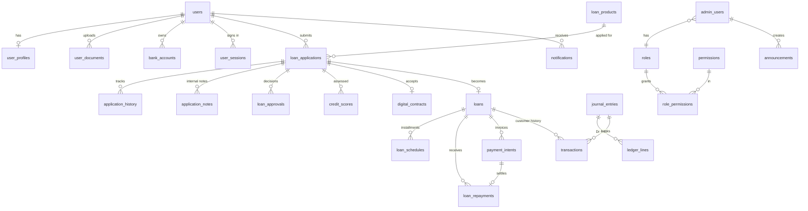

# Database

PostgreSQL 16, UTF-8. Schema: [`apps/api/prisma/schema.prisma`](../../apps/api/prisma/schema.prisma). Migrations: `apps/api/prisma/migrations`.

```bash
npm run db:migrate          # create/apply migrations in development
npm -w @orgil/api run prisma:deploy   # apply in staging/production (release job)
npm run db:seed             # roles, permissions, staff, settings, products, demo customers
```

## Conventions
- UUID primary keys; `created_at`/`updated_at` timestamps; snake_case tables via `@@map`.
- Money `NUMERIC(18,2)`; rates `NUMERIC(9,4)` (percent). **No floats.**
- Sensitive fields encrypted with AES-256-GCM (`*_enc`) and searchable through HMAC blind indexes (`*_hash`); last-4 kept for display.
- Financial history is append-only: `transactions`, `journal_entries`, `ledger_lines`, `loan_repayments`, `audit_logs`, `application_history`. Corrections are new entries.
- Applications snapshot applicant data, pricing terms and the quote at submission — later product edits never change existing applications or loans.

## Entity relationships



## Tables

| Table | Purpose |
|---|---|
| `users` | Phone identity, scrypt password hash, status, lockout, language, notification prefs |
| `user_profiles` | Name, encrypted register number, DOB, employment & income, KYC status |
| `user_documents` | KYC files (encrypted storage key, SHA-256 for duplicate detection) |
| `bank_accounts` | Payout accounts (encrypted number + blind index) |
| `user_sessions` | Refresh-token sessions (hash only), device, IP, revocation |
| `loan_products` | Admin-configured pricing, limits, terms, eligibility, availability, authorization flag |
| `loan_applications` | Requests with immutable applicant/terms/quote snapshots |
| `application_history` / `application_notes` | Status timeline / internal staff notes |
| `loan_approvals` | Each human decision with reason and linked score |
| `credit_scores` | Explainable assessment: score, grade, PD, DTI, factors, policy checks, fraud flags, model version, data source |
| `digital_contracts` | Agreement text, SHA-256, acceptance timestamp/IP/UA |
| `loans` | Booked loans with frozen pricing; optimistic-lock `version` |
| `loan_schedules` | Per-installment due vs paid components, waived interest, status, reminder tracking |
| `loan_repayments` | Applied payments with allocation breakdown and receipt number |
| `payment_intents` | Provider invoices, idempotency key, status machine, callbacks, reconciliation |
| `transactions` | Customer-facing history (disbursement, repayment, fee, penalty, refund) |
| `journal_entries` / `ledger_lines` | Double-entry general ledger |
| `notifications` / `notification_templates` / `announcements` | In-app messaging (MN + EN) |
| `admin_users` / `roles` / `permissions` / `role_permissions` | Staff RBAC with TOTP MFA |
| `audit_logs` | Who did what, before/after (PII redacted), IP, UA, request id |
| `system_settings` | Runtime policy parameters (DTI cap, limits, penalty cap, reminder days, …) |

## Useful checks

```sql
-- Every journal balances
SELECT journal_id FROM ledger_lines GROUP BY journal_id HAVING SUM(debit) <> SUM(credit);
-- Outstanding principal agrees with schedules
SELECT l.loan_no FROM loans l JOIN loan_schedules s ON s."loanId" = l.id
GROUP BY l.id HAVING l."outstandingPrincipal" <> SUM(s."principalDue" - s."principalPaid");
```
(Columns are camelCase in SQL because Prisma maps field names; quote them.)
